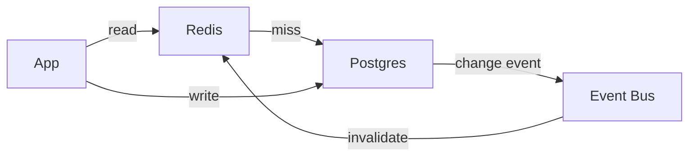

Good docs get the right idea into a reader's head before they stop reading. Most readers skim. They are smart and busy, and they will leave the moment the page stops paying off. They also don't know the system the way you do, and that gap is where most bad docs come from. You have the whole codebase in mind, so a phrase that feels precise to you can be noise to them.

When goals conflict, correctness wins, then clarity, then speed, then charm. Short text is useful because it is fast to read. It is never a goal by itself.

## Know who you're writing for

Before drafting, get a clear picture of the reader: who they are, what they want to do after reading, what they already know, and which part of the topic will be hard for them. These answers decide almost everything else, including vocabulary, what to skip, and where to spend the most care. If the user doesn't say who the audience is, infer it from the content and state your guess briefly in your reply.

Different kinds of docs serve different moods, so their shapes differ too:

| Type                     | Reader's mood           | Typical shape                                |
| ------------------------ | ----------------------- | -------------------------------------------- |
| Tutorial                 | "Teach me."             | Small steps, each with a visible result      |
| How-to                   | "I have a task."        | Goal → prerequisites → steps → how to verify |
| Reference                | "I need one fact."      | Consistent entries and tables, no story      |
| Explanation / design doc | "Help me understand."   | Big picture → diagram → parts → trade-offs   |
| Runbook                  | "Something is on fire." | Symptom → check → fix, no jokes              |

## Lead with the overview

A reader can stop at any heading, so each stopping point should leave them better off. That usually means the first screen answers three questions: what this is, why it matters, and what to do next. A short TL;DR and a big-picture diagram often do this well. Details, edge cases, and reference material go further down, and long optional detail can sit in a collapsible block.

Treat this as a tendency, not a template. A one-command README should just lead with the command. A runbook should lead with the symptom. A reference page can let its table of contents be the overview.

The overview introduces the things the reader will meet. It shouldn't state rules about things the reader hasn't seen yet, because a rule about something unseen has nothing to attach to.

Headings work as a second, faster document. Someone who reads only the headings should still get the outline of the idea, so headings that state a fact ("Retries are not idempotent") beat generic ones ("Details"). Skimmers read down the left edge and the first few words of each line, so put the meaningful word first.

## Clear before short

Write each sentence so a newcomer can understand it, and only then cut what adds nothing. The common failure goes the other way. You trim words to look concise, the remaining nouns fuse into a dense phrase, and only you can decode it. A clear sentence of 25 words beats a vague one of 12.

If a reader asks "what does this mean?", treat that as a sign the sentence failed. Rewrite the sentence until it needs no explanation, rather than explaining it in a reply.

## Sentences that sound like a person

Aim for the voice of a senior engineer explaining the system to a smart colleague at a whiteboard: relaxed, direct, and specific.

Some habits make text clear. Active voice names who does what. Plain words beat fancy ones ("use", not "utilize") and buzzwords add nothing. Each sentence should carry one main idea, though it can bring its reason or condition along. Keep the small words, like articles and prepositions, because they carry the relationships between nouns. Long stacks of nouns are hard to parse, so unpack them with a verb or "of". Put conditions before actions ("If X, do Y") and warnings before the step they warn about.

Other habits make simple English sound robotic. Chopping one thought into short fragments forces the reader to reconnect them alone. A row of same-length sentences reads like telegrams. Repeating the full noun when "it" is obvious feels mechanical. Avoiding contractions in normal prose makes text stiff, though "do not" is still the safer choice inside warnings.

Sentences connect best when each one starts with something the reader just saw and ends with the new information. Connective words like "because", "so", "but", and "which means" tell the reader how ideas relate, so they don't have to guess. A short sentence after a couple of longer ones lands as emphasis.

> **Robotic:** The cache stores results. The cache expires after 5 minutes. Stale results are possible. Set a lower TTL for critical data.
>
> **Connected:** The cache keeps results for 5 minutes, so you might see data that's up to 5 minutes old. If that's too stale for your feature, set a lower TTL.

Numbered procedures are the exception where strictness helps. One action per step, written as an instruction, with any explanation in a short note underneath.

## Precise words

Domain terms are fine when the audience knows them. Anything else should be defined where it first appears, ideally in the same sentence, and before it is used rather than after. A term used before its definition forces the reader to hold a blank in their head.

Keep one word for one concept. If you switch words, readers assume you switched concepts. The reverse matters just as much: one word should not cover two concepts. A common trap is using the same word for the system's internal key and for the real-world value it stores, which makes correct statements look contradictory.

Watch for words that point at something without naming it, like "thing", "part", "version", "rule", or "the key point". Each one makes the reader guess "which one?". Name the exact thing, and where it helps, show an example with realistic values.

Define things by what they are, such as their source, contents, or job. A definition by negation ("X is not Y") tells the reader what to discard but not what to keep.

Internal names from the implementation, like query operators, framework terms, or internal stage names, mean little to most readers. Describe what the reader can do or will see instead, unless they work with those names directly.

## Order of information

People follow ideas more easily when the order matches how understanding builds up. Show a thing before stating a rule about it. Give the cause before the conclusion, so the decision doesn't look arbitrary. Include the reason with a rule, because a rule with its "why" is easier to remember and to apply to new cases. Put each fact where the reader will use it, and say it once.

## Guiding attention to the hard part

Most docs are mostly easy with one or two parts that need real attention. Readers spread attention evenly unless something tells them to slow down, so make the hard part look and feel different.

The eye stops at what stands out, so give the hard part a diagram, table, or alert while easy parts stay plain. Emphasis only works when it's rare. If every paragraph has bold text and every screen has an alert, nothing stands out. Signposting helps ("this next part is the tricky one"), and so does a change of pace: easy parts can move quickly in bullets, while the hard part slows down with a concrete example of real input and output.

Analogies help when the reader has no mental model yet, and feel condescending when they do. One analogy per concept is enough. If the comparison might mislead, say where it breaks.

## Humor

A little humor keeps skimmers reading, but it should never cost clarity. Dry, kind, and self-aware about software pain works best. The best jokes carry information too, like a warning or a reason. Low-stakes spots like headings, TL;DRs, asides, and example names suit humor. Warnings, procedures, runbooks, and security sections do not. Avoid jokes at the reader's expense ("simply", "obviously"), dated slang, and references the audience may miss. A clean doc with no jokes beats one with a forced joke.

## What to leave out

Cutting is for filler and repeats, not meaning or flow. Good candidates are content added "just in case", facts repeated in several places, throat-clearing openings ("This document aims to..."), steps the audience obviously knows, history that doesn't explain a decision, and vague hedging that could be replaced with the actual condition. Keep the reasons behind rules, the connecting words, and the examples, even when that makes a passage longer. A useful test: would a newcomer notice if this line disappeared?

## Markdown reference

Markdown is small, so it pays to use all of it on purpose. Choose the format by the shape of the information:

| Information shape                        | Good fit                                | Weaker choice                   |
| ---------------------------------------- | --------------------------------------- | ------------------------------- |
| Comparing things on the same attributes  | Table                                   | Parallel paragraphs             |
| Ordered steps                            | Numbered list                           | Bullets or prose                |
| A handful of unordered items             | Bullets                                 | A long comma sentence           |
| An explanation built on cause and effect | Paragraph                               | Bullets that drop the "because" |
| A flow, sequence, or architecture        | Mermaid diagram                         | Prose describing boxes          |
| A short code path                        | Arrows: `request → auth → handler → db` | A paragraph                     |
| Something to copy and run                | Code block with a language tag          | Inline prose                    |
| A change to code or config               | `diff` block                            | "Change line 4 to..."           |
| Must-not-miss information                | GitHub alert                            | Bold buried in a paragraph      |
| Long detail most readers skip            | `<details><summary>`                    | Making everyone scroll          |
| A checklist the reader works through     | Task list `- [ ]`                       | Plain bullets                   |
| Keyboard shortcut                        | `<kbd>Ctrl</kbd>+<kbd>C</kbd>`          | Plain text                      |
| A side note or citation                  | Footnote `[^1]`                         | A long parenthetical            |
| A new term                               | _Italic_ at first use                   | Bold                            |
| Sample data that shows a concept         | Small table or code block               | Abstract description            |

**Alerts.** GitHub supports five kinds. NOTE is for useful context, TIP for an optional better way, IMPORTANT for something needed to succeed, WARNING for a risk to read before acting, and CAUTION for the bad outcome of a specific action. They lose their power when overused.

```markdown
> [!WARNING]
> If the event bus is slow, users see stale data.
```

**Diagrams.** A diagram earns its place when the reader would otherwise juggle more than about three connected parts. Mermaid covers most needs: `flowchart` for components and decision logic, `sequenceDiagram` for who calls whom, `stateDiagram-v2` for an object's lifecycle, `erDiagram` for data models, and `gantt` or `timeline` for plans. Diagrams read best with fewer than ten nodes, verbs on the arrows, the same names as the text, and one sentence underneath saying what to notice. Bigger systems work better as an overview plus zoomed-in diagrams.

**Layout.** Blank lines give the eye a rest. Horizontal rules mark real topic changes. Nesting shows that something belongs to the item above, and it gets hard to follow past two levels. Centering works on GitHub with `<div align="center">`, which suits a hero line or main diagram, while body text reads best left-aligned. A few emoji as signposts (✅ ❌ in a comparison table) help, but decoration on every bullet doesn't. Long docs benefit from a table of contents.

**Renderers differ.** GitHub supports alerts, Mermaid, `<details>`, footnotes, and task lists. Some wikis and Confluence don't. Use what the target renders, and if you don't know the target, assume GitHub-flavored Markdown and say so.

## Checking your work

You can't easily see your own gaps, because you already know what you meant. For anything longer than a page, a reader without your context is the best check. If you can spawn a subagent, give it only the doc, not the codebase, and ask what it couldn't understand, which terms it met before their definition, and where the text felt choppy.

When reviewing a paragraph yourself, it helps to ask what question the paragraph answers, whether each sentence could be illustrated with a real example, and whether every term was defined before this point. If a paragraph can't name its question, it probably has no job.

## Example

**Before**

> This document aims to provide an overview of the caching layer which was introduced in order to improve performance. It should be noted that the cache utilizes a write-through strategy, and invalidation is handled by the event bus, which means that if events are delayed, stale data may potentially be served to users, so care should be taken when modifying the invalidation logic.

**After**

````markdown
## The cache sits in front of Postgres

Reads go to Redis first. If Redis doesn't have the value, the app reads Postgres and fills the cache on the way back.



Writes always go straight to Postgres. Each write then sends an event that clears the old cache entry, so the next read fetches fresh data.

> [!WARNING]
> If the event bus is slow, users see old data until the event arrives.
> Test any change to invalidation with the bus delayed. Stale data is quiet: it doesn't page you, users notice first.
````

The heading states the point, the diagram gives the overview, the sentences link cause to effect, and the one risky part sits in a warning with the reason to care built into the joke.
