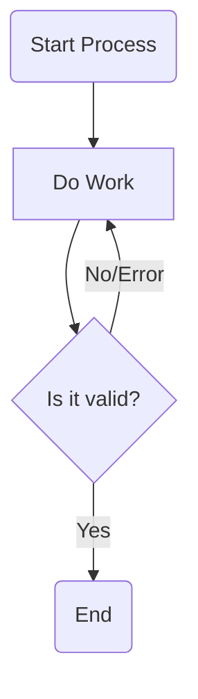
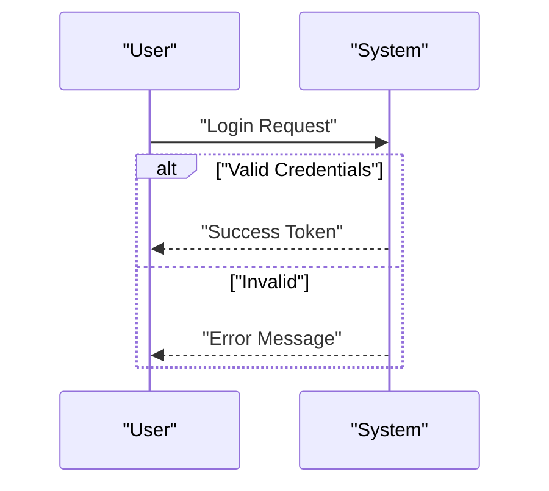
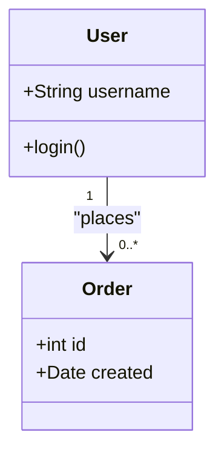
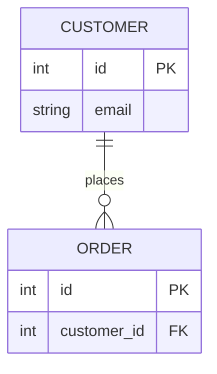

# mermaid-diagrams

Mermaid is a JavaScript-based tool that renders Markdown-inspired text definitions to create and modify diagrams dynamically.

Available Diagram Types:

- Flowchart
- Sequence Diagram
- Class Diagram
- Entity Relationship Diagram (ERD)

## Core Principles

**Adhere to these rules strictly to ensure rendering success:**

1. **Validity**: Always generate valid MermaidJS syntax.
2. **Simplicity**: Prefer clarity and compatibility. Avoid "beta" or complex features.
3. **No Styling**: Do **NOT** use `style`, `classDef`, `linkStyle`, or inline styling. Do **NOT** apply colors, strokes, or dash arrays. Keep the diagram raw and clean.
4. **Quoting**: Quoting: Always use standard double quotes (`"..."`) for text labels. Do NOT use Markdown strings (`"`...`"`). Use `<br/>` for newlines and `#quot;` for literal quotes. Always use double quotes for labels containing special characters (spaces, `()`, `[]`, `{}`, `/`, `:`, `-`).
    * *Bad*: `A -- User Action --> B`
    * *Good*: `A -- "User Action" --> B`
5. **Node Shapes**: Stick to simple node definitions: `[]` (rectangle), `()` (round), `{}` (rhombus/decision).

## Supported Diagram Types

### 1. Flowchart (`flowchart`)

Used for workflows, decision trees, and process maps.

* **Direction**: Use `TD` (Top-Down) or `LR` (Left-Right).
* **Nodes**: `id["Label Text"]` or just `id`.
* **Edges**:
  * Solid: `-->`
  * Dotted: `-.->`
  * With Text: `-- "Label" -->` or `-. "Label" .->`
* **Subgraphs**: Use for grouping logic.

**Example**:



### 2. Sequence Diagram (`sequenceDiagram`)

Used for interactions between actors/systems over time.

* **Participants**: Define aliases explicitly if names are long: `participant A as "Long Name"`.
* **Messages**:
  * Solid (Synchronous): `->>`
  * Dotted (Response): `-->>`
* **grouping**: Use `alt`/`else` for logic, `loop` for iterations, `opt` for optional steps.
* **Note**: `Note over A,B: Text`.

**Example**:



### 3. Class Diagram (`classDiagram`)

Used for object-oriented modeling and system structure.

* **Relationships**:
  * Inheritance: `<|--`
  * Composition: `*--`
  * Aggregation: `o--`
  * Association: `-->`
* **Cardinality**: Place in quotes: `"1"`, `"0..*"`.
* **Members**: Define types and visibility (`+`, `-`) cleanly.

**Example**:



### 4. Entity Relationship Diagram (`erDiagram`)

Used for database schemas and data modeling.

* **Cardinality**:
  * `||` (Exactly one)
  * `|{` (One or more)
  * `o|` (Zero or one)
  * `o{` (Zero or more)
* **Attributes**: Define inside `{}` block with `type name`.
* **Keys**: Use `PK` (Primary Key) and `FK` (Foreign Key).

**Example**:



## References

For complex edge cases or obscure syntax, consult:

* `references/flowchart.md`
* `references/sequence.md`
* `references/class.md`
* `references/erd.md`

```

